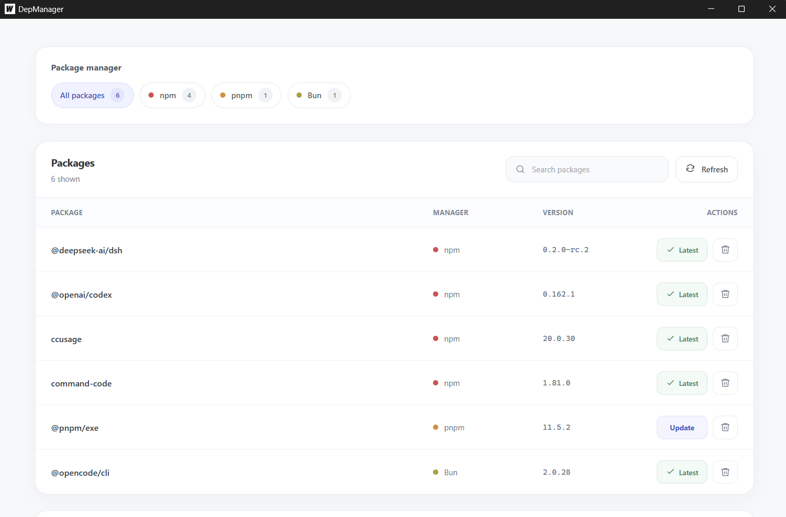

# DepManager

A desktop app for viewing and managing global JavaScript packages across **npm, pnpm, and Bun**, built with Go, Wails v3, React, and TypeScript.



## Features

- Detect installed package managers and list their global packages in one place.
- Filter by package manager and search by package name, version, or manager.
- Compare installed versions with the registry's `latest` tag.
- Update individual packages, repair incomplete installs, or remove packages with confirmation.
- Check GitHub releases for app updates, download verified installers, and restart automatically.

## Install

Download a build from [GitHub Releases](https://github.com/mr-mods-yg/dep-manager/releases/latest).

| Platform | Release asset | Installation |
| --- | --- | --- |
| Windows x64 | `depmanager-amd64-installer.exe` | Run the installer. It installs for the current user. |
| Debian / Ubuntu x64 | `depmanager_<version>_amd64.deb` | Install the downloaded package with `sudo apt install ./<filename>.deb`. |

Linux builds use GTK 4 and WebKitGTK 6.0, targeting Ubuntu 24.04+ and Debian 13+. The Debian package declares the required runtime libraries. npm, pnpm, and Bun are optional: only managers available on your `PATH` are enabled.

## Managing packages

Use **Refresh** to rescan installed managers and packages. **Update** asks the selected manager to install the latest package version. The **Latest** badge appears when the installed version matches the registry's latest version. If the registry cannot be reached, **Retry** runs the version check again. Package actions show live stages such as **Preparing**, **Downloading**, **Installing**, **Removing**, and **Refreshing**. Commands that leave the package unchanged report **No changes**, with full command output available in an expandable section.

Installed versions come from the manager's package list. If npm or pnpm omits a version, DepManager checks that package's local `package.json` in the global installation directory. It never uses a registry version as a substitute for an installed version.

If the installed version still cannot be read, the row shows **Incomplete install** and offers **Repair**. For npm, repair runs `npm install --global <package>@latest`; this reinstalls the package and its manifest. An interrupted install can leave a package folder without a `package.json`, which is why a version may be unavailable.

Bun packages are read from its configured global directory, including `BUN_INSTALL` and `bunfig.toml` settings. Package aliases retain their installed dependency name so actions target the correct entry.

## Application updates

The update panel below the package list shows the running app version and a **Check for updates** button. DepManager checks this repository's latest stable GitHub release on startup and every six hours while the app stays open.

**Automatically install updates** is enabled by default for supported production builds. Turn it off to review available releases and use **Update now** when ready. The preference is saved locally.

Updates download the installer for the current platform and architecture, verify its SHA-256 checksum against the release's `SHA256SUMS` file, and install it. Releases without a matching checksum are rejected. This protects against corrupted downloads; it is not a publisher signature.

- **Windows:** the app closes, runs the per-user installer silently in the existing installation directory, and relaunches. If installation fails, the helper records the error and attempts to reopen the app.
- **Debian / Ubuntu:** `pkexec` authorizes `dpkg` to install the downloaded package. A graphical polkit authentication agent must be available; the system may ask for your password. The app restarts as the original user after installation succeeds.

App updates wait for package actions to finish, and package changes are blocked while the application updates. Download and installation failures are shown in the update panel. Automatic installation is attempted once per release to avoid repeated restart attempts; use **Update now** to retry a failed update.

Development builds can check releases but cannot install app updates. Automatic installation currently supports Windows x64 and Debian / Ubuntu x64.

## Development

Requirements:

- Go 1.25 or newer, matching `go.mod`.
- Node.js 24 with npm.
- Wails CLI `v3.0.0-beta.28`.
- Platform build dependencies: WebView2 on Windows, or GTK 4 / WebKitGTK 6.0 development libraries and a C compiler on Linux.

Install the CLI and frontend dependencies from the repository root:

```sh
go install github.com/wailsapp/wails/v3/cmd/wails3@v3.0.0-beta.28
cd frontend
npm ci
cd ..
```

Ensure the Go binary directory is on your `PATH`, then start the desktop app:

```sh
wails3 dev -config ./build/config.yml -port 9245
```

The development server binds to `127.0.0.1:9245`. A browser alone does not provide the desktop service bindings; use the Wails app for package and update operations.

## Build and verify

Build a production desktop executable:

```sh
wails3 build
```

Create a Windows per-user installer (requires NSIS):

```sh
wails3 task windows:package ARCH=amd64 INSTALL_SCOPE=user
```

Create a Debian package on Linux:

```sh
wails3 task linux:create:deb ARCH=amd64
```

Generated executables and packages are written to `bin/`.

Run backend tests and check the frontend build:

```sh
go test ./...
cd frontend
npm run build
```

After changing bound Go services, regenerate their TypeScript bindings:

```sh
wails3 generate bindings -ts -i
```

## Project layout

| Path | Purpose |
| --- | --- |
| `main.go` | Desktop window, service registration, and embedded app version/assets. |
| `packageservice.go` | Manager discovery, installed-version recovery, and package actions. |
| `updates/` | Update service, platform installation helpers, build-mode controls, tests, and release version script. |
| `frontend/src/` | React interface and application update controls. |
| `frontend/public/style.css` | App styling and loading animations. |
| `frontend/bindings/` | Generated Wails service bindings. |
| `build/` | Platform packaging, metadata, icons, and development configuration. |
| `.github/workflows/release.yml` | Version bump, desktop builds, checksums, and GitHub release publication. |

## Releases

Pushes to `main` trigger the release workflow. It runs `node updates/bump-version.cjs`, increments the patch version across app and package metadata, commits the version change, and tags the release. Windows and Linux jobs then build their packages, and the publish job uploads both assets with `SHA256SUMS`.

The app embeds its version from `frontend/package.json`, keeping update comparisons aligned with release tags. Older installed versions that predate the in-app updater need a manual upgrade to a release containing this feature first.
